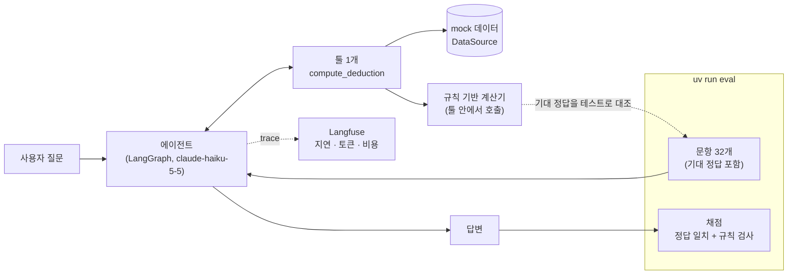

# tax-agent-eval

> 연말정산 어시스턴트 에이전트를 **측정하고 개선하는** 평가·관측성·비용 비교 체계. (작성 중)

## 문제
LLM 에이전트는 몇 시간이면 만들 수 있지만, 프롬프트·모델·툴을 바꾼 뒤 **정말 좋아졌는지는 감으로 판단하기 쉽다.** 답변이 그럴듯해 보여도 숫자가 틀렸거나, 부르지 말아야 할 툴을 불렀거나, 툴 결과에 없는 금액을 지어냈을 수 있다. 같은 질문 한 번에 시간과 비용이 얼마나 드는지도 보통 모른다.

이 프로젝트는 에이전트를 **측정 대상**으로 두고, 바꿀 때마다 같은 평가셋으로 정확도·지연·비용을 다시 재는 체계를 만든다. 평가를 처음부터 반복 실행할 수 있는 형태로 만드는 것이 목표다.

도메인은 **연말정산**이다. 공제 규칙이 명확해서 정답 금액을 코드로 계산할 수 있고(LLM 답과 비교 가능), 대상이 아닌데 공제된다고 답하는 식의 실패를 평가 문항으로 만들기 좋다.

## 구조


- **에이전트는 공제액을 직접 계산하지 않고 툴을 호출한다.** 기본 에이전트의 툴은 `compute_deduction` 하나다. 이 툴이 사용자 프로필과 자료를 `DataSource`에서 가져와 규칙 기반 계산기(국세청 2025 귀속 안내 책자 기준)로 계산하고, 에이전트는 결과를 설명할 뿐이다. 같은 계산기가 평가 정답의 기준이기도 하다. 문항의 기대 정답은 데이터셋에 손으로 적어 두고, 테스트가 계산기 결과와 일치하는지 매번 대조한다.
- **에이전트 변형이 3개 있다.** 기본은 위의 통합 툴(`combined`)이고, 비교를 위해 단계별 툴(프로필 → 데이터 → `calc_deduction`을 모델이 차례로 호출, `calculator`)과 계산기 없는 대조군(`no_calculator`)을 남겼다. 통합 툴이 기본이 된 이유는 아래 "결과"와 "설계 결정" 5번이다.
- **툴은 데이터 출처를 모른다.** 툴은 `DataSource` 인터페이스만 호출하고, 지금은 가상 인물 29명의 mock 데이터가 들어 있다. 나중에 실데이터로 바꿀 때 구현만 갈아 끼우기 위한 경계다.
- 모듈별 역할과 import 그래프는 [`docs/architecture.md`](docs/architecture.md)에 있다.

## 실행 방법
```bash
uv sync
cp .env.example .env   # ANTHROPIC_API_KEY 입력 (Langfuse 키는 선택: 둘 다 넣으면 트레이싱이 켜진다)
uv run tax-agent "올해 카드 소득공제 얼마나 받을 수 있어?" --user user_a   # 기본 에이전트(통합 툴). --variant calculator면 단계별 툴 호출이 보인다
uv run eval            # 평가셋 32문항, 기본 에이전트 (실제 모델 호출, 1회 약 2센트. 실행 전에 예상 비용을 출력한다)
uv run eval --variant calculator   # 단계별 툴 에이전트 (--group basic|exact|sweep 로 한 그룹만)
uv run eval --no-calculator        # 대조군: 계산기 툴 없이 모델이 직접 계산
uv run eval-compare --since <시각>   # 저장된 결과를 방식별로 비교 (예: 20261114-150702, 결과 파일 이름의 UTC 시각)
uv run pytest          # 단위 테스트 (모델 호출 없음)
```

### CI (GitHub Actions)
`.github/workflows/ci.yml`: 푸시와 PR마다 `uv run pytest`(모델 호출 없음). `main` 푸시와 수동 실행에서는 이어서 **회귀 평가**를 돌린다. 고정한 8문항을 실제 모델에 물어 통과율이 85% 미만(8개 중 6개 이하)이면 실패시키고, 예상 비용이 $0.05를 넘으면 모델을 부르기 전에 중단한다. PR에서는 돌리지 않고, `ANTHROPIC_API_KEY` 저장소 비밀값이 없으면 평가를 건너뛴다. 같은 명령을 로컬에서 돌려 보려면 다음과 같다. 2026-11-19에 이 명령으로 8/8 통과(추정 $0.0048)를 확인했고, GitHub에서의 첫 실행은 아직 확인하지 않았다.
```bash
uv run eval --only card-01,rent-01,med-01,ask-01,edge-01,edge-02,multi-01,exact-01 --min-pass-rate 0.85 --max-estimated-cost 0.05
```

## 결과
모델 `claude-haiku-5-5`, 2026-11-14~15. 평가셋은 32문항이다. **기본 20**(카드·월세·의료비 계산, 대상 아님 함정, 틀린 전제, 되묻기, 지원 안 하는 항목, 없는 사용자, 두 항목 동시 질문 등), **원 단위 6**(금액이 딱 떨어지지 않는 문항), **길이 스윕 6**(총급여는 같고 카드 사용 카테고리만 1~6개로 늘려 계산이 길어질수록 비용이 어떻게 변하는지 보는 문항). 한 문항은 정답 일치와 규칙 검사를 모두 통과해야 통과다. 같은 문항으로 에이전트 3가지를 비교했다.

- **계산기**(`calculator`): 프로필 → 데이터 → `calc_deduction` 순서로 단계별 툴을 부르고, 계산은 규칙 기반 계산기가 한다.
- **대조군**(`no_calculator`): 계산기 툴 없이 같은 규칙을 프롬프트에 텍스트로 주고 모델이 직접 계산한다. 계산기 전용 규칙 검사는 뺀다.
- **통합 툴**(`combined`): `compute_deduction` 툴 하나가 조회·데이터·규칙 계산을 코드 안에서 다 한다. 모델 호출이 최소 2번(툴 요청, 결과 설명)이다. 호출 순서·숫자 전달 검사는 단계가 없어 뺀다.

세 방식을 **번갈아** 실행해 API 속도 변동이 같이 걸리게 했다(basic 3세트, exact 5세트, sweep 5세트, 총 39회). 명령은 `uv run eval --group <basic|exact|sweep> --variant <calculator|combined>` 또는 `--no-calculator`, 비교는 `uv run eval-compare --since <시각>`이다. 표의 지연·비용은 **그룹 한 번을 돌린 값**(문항별 평균의 합)이다.

| 그룹 (문항 × 실행) | 구성 | 통과 | 지연 | 비용(추정) |
|---|---|---|---|---|
| 기본 (20 × 3) | 계산기 | **60/60** | 131.7초 | $0.0235 |
| | 대조군 | 59/60 | 131.5초 | $0.0236 |
| | 통합 툴 | **60/60** | 102.8초 | $0.0121 |
| 원 단위 (6 × 5) | 계산기 | **30/30** | 42.6초 | $0.0074 |
| | 대조군 | 30/30 | 46.5초 | $0.0080 |
| | 통합 툴 | **30/30** | 33.0초 | $0.0038 |
| 스윕 (6 × 5) | 계산기 | **30/30** | 43.6초 | $0.0071 |
| | 대조군 | 30/30 | 50.5초 | $0.0085 |
| | 통합 툴 | **30/30** | 30.9초 | $0.0036 |

32문항을 한 번 돌린 합계(위 세 그룹의 합):

| 구성 | 입력 토큰 | 출력 토큰 | 모델 호출 | 지연 | 비용(추정) |
|---|---|---|---|---|---|
| 계산기 | 233,309 | 29,339 | 114.8 | 217.9초 | $0.0380 |
| 대조군 | 210,717 (-10%) | 38,192 (+30%) | 87.2 (-24%) | 228.4초 (+5%) | $0.0402 (+6%) |
| 통합 툴 | 82,063 (-65%) | 22,844 (-22%) | 67.0 (-42%) | 166.8초 (-23%) | $0.0196 (-48%) |

(괄호는 계산기 대비. 출력 토큰에는 숨은 추론 토큰이 들어 있고 계산기 10,031 · 대조군 17,519 · 통합 툴 9,971개다.)

**이 결과가 말하는 것**
- **정확도**: 틀린 것은 대조군뿐이다. 같은 날 앞서 계산기·대조군만 번갈아 돌린 배치(26회, basic 3·exact 5·sweep 5세트)와 합치면 **계산기 0/240, 통합 툴 0/120, 대조군 5/240** 실패다(두 배치의 계산기·대조군 합계는 5% 안에서 같았다). 대조군 실패는 두 문항에 몰려 있다. 되묻기 문항 `ask-01`(6회 중 3회)은 규칙을 잘못 적용한 오류였다. 신용카드에서 최소 사용액을 뺀 뒤 나머지 카테고리를 "남는 금액 없음"으로 보고 공제를 0으로 처리해 5,300,000원 대신 1,950,000원을 답했다. 스윕 문항 `sweep-3`(10회 중 2회)은 5,026,540 + 3,762,120을 8,788,710으로 적은 50원짜리 덧셈 실수였고 최종값이 1,581,549원 대신 1,581,564원이 됐다. 같은 문항이 어떤 배치에서는 맞고 어떤 배치에서는 틀려서 오류는 간헐적이다.
- **계산기가 대조군보다 싸거나 빠르냐는 문항에 따라 다르다.** 합계로는 비용 +6%, 지연 +5%로 비슷하다. 카드처럼 계산이 길면 대조군이 불리하고(기본 그룹 카드 출력 토큰 +42%, 지연 +7%), 월세·의료비처럼 짧으면 대조군이 약간 유리하다(출력 토큰 -7%·-1%, 지연 -7%·-5%). 스윕에서 카테고리가 1개에서 6개로 늘면 대조군의 출력 토큰은 계산기 대비 +11%에서 +131%로 벌어지고, 계산기는 886개에서 932개로 거의 변하지 않았다.
- **통합 툴이 가장 싸고 빨랐고 틀리지 않았다.** 비용이 계산기의 절반이다(-48%, 세 그룹 모두 -48~49%). 이유는 모델 호출 수가 42% 줄고, 호출당 입력 토큰도 2,032개에서 1,225개로 40% 줄어서(툴 정의가 5개에서 1개로 줄고 대화가 짧아진 영향으로 보이나, 이 둘을 따로 재지는 않았다) 입력 토큰이 65% 줄었기 때문이다. 비용에서 입력 토큰이 차지하는 비중은 계산기 61%, 대조군 52%, 통합 툴 42%였다. 출력·추론 토큰은 거의 같았다(추론 -1%).
- **통합 툴이 잃는 것**: 모델이 숫자를 한 툴에서 다른 툴로 옮기지 않으니 "계산기에 넘기다 숫자가 바뀐다"는 실패가 없어지고, 평가도 그것을 재지 못한다(계산기 쪽의 `args_relayed` 검사에 해당하는 것이 없다). 프로필·데이터가 툴 안에서 처리되어 모델은 `inputs`로 돌려받은 값만 본다.

### 모델 비교: Haiku 5.5 대 `gpt-6.2-sol`
기본 에이전트(통합 툴)를 두 모델로 같은 문항에 번갈아 돌렸다(2026-11-18, 기본 3·원 단위 5·스윕 5세트, 총 26회). 명령은 `uv run eval --group <basic|exact|sweep> --model <claude-haiku-5-5|openai:gpt-6.2-sol>`, 비교는 `uv run eval-compare --since <시각>`이다. `gpt-6.2-sol`은 OpenAI의 가장 새로운 세대(GPT-6.2)의 중간 등급 모델이다(OpenAI 모델 비교 페이지 기준, 2026-11-18).

| 구성 (32문항 한 번 합계) | 통과 | 입력 토큰 | 출력 토큰 | 모델 호출 | 지연 | 비용(추정) |
|---|---|---|---|---|---|---|
| `claude-haiku-5-5` | **120/120** | 82,052 | 22,930 | 67.0 | 153.0초 | $0.0197 |
| `gpt-6.2-sol` | **120/120** | 39,195 (-52%) | 5,774 (-75%) | 67.5 (+1%) | 206.1초 (+35%) | $0.1361 (+592%) |

- **정확도는 같았다.** 두 모델 모두 이 문항에서 틀린 적이 없다(120/120). 단 `gpt-6.2-sol`은 채점기가 못 알아본 답이 5건 나왔고(아래), 고쳐서 다시 판정한 값이다.
- **비용은 `gpt-6.2-sol`이 약 7배**($0.1361 대 $0.0197), 지연은 35% 길었다. 단가가 20배(입력 $2/출력 $10 대 $0.10/$0.50 per 1M)인데 토큰이 적게 든 만큼 줄어든 결과다.
- **토큰은 모델 사이에서 직접 비교하면 안 된다.** 호출당 입력 토큰이 Haiku 1,225개, `gpt-6.2-sol` 580개인데, 토크나이저가 달라 같은 문장이 다른 개수로 센다. 비교할 수 있는 것은 비용과 지연이다. `gpt-6.2-sol`은 출력이 호출당 86개로 짧았고, 추론 토큰은 거의 0으로 집계됐다(추론을 하지 않는 것인지 응답에 보고되지 않는 것인지는 구분하지 못한다). Haiku는 출력의 44%가 추론 토큰이다.

**채점기가 Haiku의 표현에 맞춰져 있었다.** 평가 규칙은 Haiku의 답변을 보며 다듬었기 때문에, `gpt-6.2-sol`의 답변에서 올바른 답이 틀린 것으로 채점된 경우가 5건(120회 중) 나왔다. "37만 5천 원"의 '천' 단위를 못 읽은 것 1건, "조회할 수 없어 … 확인해 드릴 수 없어요"라는 거절을 못 알아본 것 3건, 보험금을 "돌려받은 금액"이라고 쓴 것을 보험 언급으로 인정하지 못한 것 1건이다. 답변을 직접 읽어 모두 정상임을 확인하고 채점을 고쳤다(실패를 본 뒤의 수정이다). 이 때문에 모델 간 정확도 비교는 "같다"고 하기보다 "이 채점기로 둘 다 틀리지 않았다"가 맞고, 아직 못 찾은 표현 차이가 있을 수 있다.

**읽을 때 주의**: 문항 32개, 문항별 3~5회다. 에이전트 3방식 비교는 Haiku 5.5 한 모델로만 했고, 두 모델 비교는 기본 에이전트(통합 툴)로만 했다. 같은 문항을 반복했으므로 실행들이 독립 표본이 아니고, 대조군 5/240 대 0/240의 차이가 통계적으로 확정이라고 말하지 않는다. "정확도 100%"가 아니라 "이 문항에서는 틀린 적이 없다"는 뜻이다. 대조군에는 규칙을 텍스트로 줬으므로 규칙을 *아는지*가 아니라 *적용해서 계산하는지*만 비교했고, 다른 모델(더 작은 모델, 추론을 끈 설정)에서는 결과가 다를 수 있다. 지연은 실행마다 오차가 커서 문항 단위 차이(특히 ±20% 이내)는 잡음일 수 있다. 통합 툴의 규칙 검사는 위에 적은 대로 다른 방식과 개수와 종류가 달라 "통과"가 완전히 같은 기준은 아니다. 비용은 가격표 기준 **추정**이다. 기본 모델 `claude-haiku-5-5`는 2026-11-19에 확정했다(위 비교에서 정확도가 같고 7배 싸고 더 빨랐다).

### 합성 사용자로 재는 거래 분류 (실데이터 없음)
실제 거래 내역에는 공제 분류(신용·체크, 전통시장·대중교통·문화체육, 의료, 월세, 공제 제외)가 적혀 있지 않고 가맹점 이름만 있다. 그 이름에서 분류를 정하는 단계를 재려고 **가상 사용자 50명**(1년치 거래 16,300건, 이름이 지어낸 가맹점)을 만들었다. 정답 분류는 생성할 때 이미 정해져 있다. 이름이 분명한 가맹점("행복내과의원")과 이름만으로는 알 수 없는 가맹점("봄날 건강센터")을 섞고, 불분명한 쪽의 비율을 바꿔 가며 쟀다. 분류기를 거친 거래와 정답 거래를 같은 계산기에 넣어 공제액 차이(원)도 봤다. 명령은 `uv run sim-eval [--classifier llm] [--users 50] [--obscure 0.15]`이다.

| 분류기 | 이름 불분명 비율 | 분류 정확도 | 카드 공제 평균 절대 오차 | 비고 |
|---|---|---|---|---|
| 키워드 규칙 | 15% | 94.1% | 180,893원 (평균 +126,069원, 과대) | 모델 없음, 비용 0 |
| `claude-haiku-5-5` | 15% | **97.7%** (3회 동일) | **43,681~47,086원** (평균 -43,681~-47,086원, 과소) | 3회 실행, 회당 약 $0.002 |
| 키워드 규칙 | 30% | 87.6% | 358,087원 (평균 +210,323원) | |
| `claude-haiku-5-5` | 30% | **95.4%** | **95,117원** (평균 -95,117원) | 1회 실행 |

- 이름이 분명하면(0%) 규칙은 100%이고, 불분명해질수록 모델과 규칙의 차이가 벌어진다. 불분명한 이름을 규칙은 일반 소비로 처리해서 **공제액을 부풀리고**, 모델은 "분류 안 됨"으로 두어서 **공제액을 낮게 잡는다**(분류 안 됨은 어디에도 세지 않는 것이 설계다). 틀리는 방향이 반대다.
- 한 사용자의 카드 공제가 원 단위로 정확히 맞은 비율은 규칙 0%, 모델 2%다. 거래 하나만 잘못 분류돼도 금액이 달라지기 때문이다. 정확도 97%가 공제액 정확도를 뜻하지 않는다.
- 월세는 "집주인 송금"처럼 이름에 월세·임대가 없으면 둘 다 분류 안 됨으로 남아 같은 오차(56,150원)가 났다.
- **한계**: 가맹점 이름과 정답 분류를 직접 지어냈고, 불분명한 이름의 비율(15%, 30%)도 임의로 정했다. 실제 가맹점 이름은 지점명·약어·영문이 섞여 더 지저분하다. 이 숫자는 "분류가 실제로 얼마나 맞는다"가 아니라 "이름이 불분명해질 때 규칙과 모델이 어떻게 갈리는가"를 보여 준다. 모델 판단은 이름만 보므로, 같은 이름이 다른 업종일 수 있는 경우는 재지 못한다.
- **측정하면서 고친 것**: 처음 모델 분류기는 23.7%가 나왔다. 모델 문제가 아니라 제 파서 문제였다. 모델이 100줄 중 99개만 답했는데 위치로 답을 맞추는 방식이라 한 줄이 빠진 뒤의 답이 전부 한 칸씩 밀렸다. 줄 번호를 키로 받도록 고치고 요청당 줄 수를 50으로 줄여 위 숫자가 나왔다.

### 합성 사용자 end-to-end (거래 → 분류 → 에이전트 답)
위 분류 단계에 에이전트를 붙여 "카드 소득공제 얼마나 받을 수 있어?" 같은 질문을 실제로 던졌다. 질문마다 숫자가 세 개다. **T**는 사용자가 실제로 받을 공제액(정답 분류로 계산), **C**는 분류기가 라벨을 붙인 거래로 계산기가 돌려주는 값(에이전트의 툴이 줄 값), **A**는 에이전트가 답한 금액이다. 그러면 오류가 층별로 갈린다. C와 T의 차이가 분류 오류, A와 C의 차이가 에이전트 오류다. 합성 사용자 20명 × 질문 3개(카드·월세·의료비) = 60개, `claude-haiku-5-5`의 기본 에이전트, 이름 불분명 15%, 각 1회다. 명령은 `uv run sim-agent --users 20 [--classifier llm]`이다.

| 분류기 | 종단 정확 (A = T) | 툴에 충실 (A = C) | 툴 값이 정답과 다른 질문 | 지연 | 비용(추정) |
|---|---|---|---|---|---|
| 키워드 규칙 | 26/60 | **60/60** | 34/60 | 242초 | $0.032 |
| `claude-haiku-5-5` | 28/60 | **60/60** | 32/60 | 236초 | $0.031 |

- **에이전트는 매번 툴 값을 그대로 전달했다**(120/120). 툴 값이 틀린 66개 질문(34 + 32)에서도 에이전트는 모두 그 틀린 값을 따랐다. 병목은 에이전트가 아니라 거래를 공제 칸으로 나누는 분류다.
- 주제별 종단 정확은 카드 0/20(규칙)·1/20(모델), 월세 10/20·10/20, 의료비 16/20·17/20이다. 카드는 거래 하나만 잘못 분류돼도 금액이 달라져 원 단위 정확은 거의 불가능했다.
- **월세 숫자는 시뮬레이터 때문에 비관적이다.** 가맹점 이름이 불분명한지를 거래마다 독립으로 정해서, 매달 나가는 월세가 한 번이라도 "집주인 송금"일 확률이 약 86%다. 월세 10/20은 사실상 월세가 없거나 대상이 아닌 사용자(정답 0)만 맞은 것이다. 실제로는 임대인 이름이 매달 같다.
- **한계**: 사용자 20명, 질문별 1회, 한 모델이다. 분류 숫자와 같은 이유로 지어낸 데이터라서 절대 정확도가 아니다. 이 결과가 말하는 것은 "툴이 있을 때 에이전트 오류는 이 설정에서 보이지 않고, 오류는 입력 데이터 쪽에서 온다"는 층 분리다.
- 첫 실행(규칙 분류기)에서 에이전트가 "해당이 없어서 받을 수 있는 금액이 없습니다"라고 올바르게 답한 1건이 채점기에 틀린 것으로 잡혔다(59/60). 표현을 못 읽은 것이라 규칙을 고치고 다시 돌렸다(위 표는 다시 돌린 값). 정규식 채점이 네 번째로 빗나간 것이다.

**채점 규칙을 사후에 고쳤다 (네 차례).** 정답 일치와 일부 규칙 검사는 답변 표현을 정규식으로 읽는데, 올바른 답이 표현이 달라 틀린 것으로 채점되는 일이 반복됐다. 1) 지원하지 않는 항목·없는 사용자를 올바르게 거절한 답변 3건(Haiku). 2) 같은 종류의 거절 표현과 "37만 5천 원"의 '천' 단위, "돌려받은 금액"(`gpt-6.2-sol`) 5건. 3) "해당이 없어서 받을 수 있는 금액이 없습니다"를 0원·대상 아님으로 못 읽은 것(합성 사용자 end-to-end). 모두 답변을 직접 읽어 정상임을 확인한 뒤 규칙을 넓혔다. 실패를 본 뒤에 바꾼 것이라 저장된 판정은 그대로 두고, `eval-compare`가 저장된 답변으로 다시 판정한다(답변 텍스트만 보는 검사까지. 툴 호출을 보는 검사는 기록이 없어 저장된 결과를 쓰고, `answer_uses_tool_amount`만 저장된 상세 문구의 계산기 값으로 다시 확인한다). `--raw`는 저장된 판정을 보여 준다. 이 문서의 표는 다시 판정한 값이다(전체 884건 중 8건의 판정이 달라졌다). 표현을 정규식으로 맞히는 방식의 한계이고, LLM-as-a-judge로 바꾸는 것이 후보다.


*`uv run tax-agent`로 질문 1개(문항 1, `user_a`)를 실행한 Langfuse trace, 2026-11-07. 평가 실행(`eval-<id>` trace)의 화면이 아니라서 위 결과 표의 수치와는 별개다.*

### 측정하면서 발견해서 고친 것
- **비용이 2배로 잡혔다.** 트레이싱을 켜자 모델 호출마다 기록이 2개(LangChain 핸들러 + Anthropic SDK 자체 스팬)씩 생겨 trace 비용이 $0.0016579로, 실제($0.0008686)의 약 2배였다. SDK 스팬을 걸러 내서 고쳤다.
- **같은 금액이 다르게 적혔다.** 답변이 "5,300,000원"과 "530만 원"을 번갈아 써서, 문자열 일치로 채점하면 정답이 오답이 된다. 두 표기를 같은 값으로 읽도록 채점기를 만들었다.
- **한도 설명이 비는 경우가 있었다.** 초기 CLI 실행에서 답변이 한도 금액은 계산 결과에 없다는 취지로 말하곤 했다(저장소에는 기록이 없고 Langfuse trace에 남아 있다). 계산기 출력에 한도(`base_limit`, `extra_deduction`)를 추가한 뒤의 평가 2회에서는 "기본 한도 300만 원에 추가 공제 230만 원이 더해져"처럼 한도를 설명한 답이 나왔다. 다만 모든 답이 그런 것은 아니다. `card-01` 1회차는 금액 없이 "한도 안에서 공제가 적용되며"라고만 답했다.

- **채점이 정상 동작을 실패로 처리했다.** 되묻기 문항에서 모델이 "무주택 세대주이신가요?"라고 되묻고 이미 조회한 데이터("총급여 5,000만 원, 월세 700만 원")를 요약했는데, "첫 응답에 금액이 있으면 실패" 규칙이 이를 실패로 처리했다. 답변을 직접 읽어 정상 동작임을 확인하고, 공제액(정답 금액)을 말했는지만 보도록 고쳤다. 실패를 본 뒤에 바꾼 것이라 [`docs/decisions.md`](docs/decisions.md)에 이유를 남겼다.
- **처음 가정은 절반만 맞았다.** "LLM은 다단계 산술을 틀리기 쉽다"고 보고 계산기 툴을 만들었다. 문항을 26개로 늘려 처음 측정했을 때는 계산기 없는 대조군이 모두 맞혀서 가정이 틀린 줄 알았는데, 32문항으로 늘려 반복하자 대조군만 5/240번 틀렸다(계산기 0/240). 그래서 아래 설계 결정의 이유를 두 번 고쳐 썼다.

## 설계 결정
전체 기록은 [`docs/decisions.md`](docs/decisions.md)에 있다.

1. **공제액은 LLM이 아니라 코드가 계산한다.** 처음에는 "LLM은 다단계 산술(25% 문턱 이월, 한도 비교)에서 틀리기 쉽다"고 가정했다. 계산기 없이 규칙만 텍스트로 준 대조군을 만들어 측정하니 `claude-haiku-5-5`는 대부분 맞혔지만(240회 중 235회) 틀린 5회는 모두 대조군이었다(위 결과). 규칙을 잘못 적용한 경우와 50원짜리 덧셈 실수였다. 그래서 계산기를 쓰는 이유는 ① 정확도(약한 근거: 5/240 대 0/240, 독립 표본이 아니다) ② 계산이 코드여야 정답이 결정적이라 평가와 회귀 테스트의 기준이 된다 ③ 계산기의 입력과 결과가 trace에 남아 틀렸을 때 "툴 선택 / 계산 / 설명" 중 어디가 문제인지 분리된다 ④ 계산이 길수록 토큰과 시간이 적다(카드). 반대로 짧은 계산(월세·의료비)에서는 계산기를 부르는 왕복 때문에 오히려 더 든다. 이 설정에서 관찰한 값이며 일반화하지 않는다.
2. **평가는 두 방식을 모두 통과해야 통과다.** 금액만 비교하면 "툴을 안 부르고 그럴듯한 숫자를 말했다"나 "계산기에 넘기다 숫자가 바뀌었다"를 못 잡는다. 규칙 검사(툴 순서, 계산기에 넘긴 숫자, 답변 금액 = 툴 결과, 정보가 없으면 되묻기)가 그것을 잡는다. 기대 정답은 손으로 적고, 테스트가 계산기 결과와 매번 대조한다.
3. **에이전트 그래프를 `create_react_agent` 없이 `StateGraph`로 직접 구성했다.** 설치된 LangGraph 1.x에서 그 함수는 deprecated이고, 직접 만든 그래프는 약 20줄이라 구조가 코드에서 그대로 보인다. `ToolNode`의 기본 설정은 툴 예외를 다시 던져 실행이 죽기 때문에 오류를 모델에게 돌려주도록 바꿨다.
4. **트레이싱은 호출하는 쪽에서 붙이고, 키가 없으면 꺼진다.** 에이전트 코드는 Langfuse를 모른다. 키 없이도 개발·테스트가 돌고, 테스트는 실수로 진짜 키를 쓰지 못하게 격리했다.
5. **툴을 하나로 합친 변형(`compute_deduction`)을 비교 대상에 추가했다.** 비용의 절반 이상이 입력 토큰이고 입력은 모델을 부를 때마다 대화 전체를 다시 보내기 때문에, 조회 → 데이터 → 계산을 한 툴로 합쳐 모델 호출을 줄였다. 결과는 같은 문항에서 비용 -48%, 지연 -23%, 실패 0/120이다. 대신 모델이 숫자를 한 툴에서 다른 툴로 옮기는 단계가 없어져 "숫자가 중간에 바뀐다"는 실패를 재지 못한다. 소유자가 이 변형을 기본 에이전트로 정했다(2026-11-18). 기본 에이전트로 `uv run eval`을 돌린 결과도 32/32 통과, 추정 $0.0197, 150.6초, 모델 호출 67회로 위 배치와 같았다(1회 실행).

## 범위와 면책
**한다**
- mock API(사용자 정보·카드 사용액·월세·의료비)를 툴로 호출하는 **단일 에이전트**. 공제 항목은 카드·월세·의료비 3개를 구현했고(교육비·연금저축은 아직 없다), 모두 2025년 귀속 국세청 안내 책자 기준이다
- **에이전트는 공제액을 직접 계산하지 않고 툴(기본 `compute_deduction`, 단계별 변형은 `calc_deduction`)을 호출한다.** 공제액과 평가의 정답 기준은 LLM이 아니라 규칙 기반 계산기가 만들고, 에이전트의 답을 이 정답과 비교하는 것이 평가의 기본이다
- 실행마다 **지연·토큰·비용 트레이싱**(Langfuse)
- 정답 일치와 규칙 검사 2가지로 채점하는 평가셋을 **명령 하나로 재실행** (LLM-as-a-judge는 아직 없다)
- 모델 비교 확대 (Haiku 5.5 대 `gpt-6.2-sol`은 했다. 로컬 양자화 모델(llama.cpp)은 뒤로 미뤘고, 더 작은 모델이나 추론을 끈 설정은 아직 안 했다)

**진행 중 / 아직 안 한다** (먼저 mock 데이터로 에이전트와 측정 체계를 만들었다. 아래 "이후 계획" 참고)
- 본인 거래 내역으로 공제 적용 현황 보기: 거래를 공제 입력으로 합산하는 계층(`transactions`)을 가상 거래로 만들고 테스트했다. 실제 데이터는 이 저장소에 올리지 않는다
- 오픈뱅킹·홈택스 등 실제 연동과 앱 UI는 아직 안 했다 (지금 데모는 CLI)

**하지 않는다**
- 범용 RAG 챗봇, 멀티 에이전트 데모

## 이후 계획
- **실제 데이터 연동과 앱으로 확장한다.** 데이터 출처를 mock에서 실제 데이터로 바꾸고 앱 UI·배포를 붙이는 것이 최종 그림이다(2026-11-18에 착수했다. 첫 단계는 본인의 소비·거래 내역을 가져와 공제에 어떻게 적용되는지 보는 것이고, 실제 데이터는 이 저장소에 올리지 않는다). 평가와 트레이싱을 먼저 만들어 두었기 때문에, 연동 후에도 같은 평가 방식(계산기로 정답을 만들고 규칙으로 검사)으로 성능이 떨어졌는지 숫자로 확인할 수 있다. 지금 문항의 사용자와 기대 정답은 mock 데이터에 묶여 있어서, 실데이터로 바꿀 때는 문항을 다시 만들어야 한다. 툴이 `DataSource` 인터페이스만 보도록 한 것도 이때 구현만 갈아 끼우기 위해서다.
- 병행해서 CI 회귀 평가, Docker 실행을 붙인다. 모델 비교에서는 이번에 만든 세 방식(계산기·대조군·통합 툴)을 모델마다 같이 돌려, 작은 모델에서 계산기의 가치가 달라지는지 본다.

지금의 모든 데이터는 가상 인물의 mock 데이터다. 세법 해석의 정확성을 보장하지 않으며, 실제 세무 판단에 쓰지 말 것.
