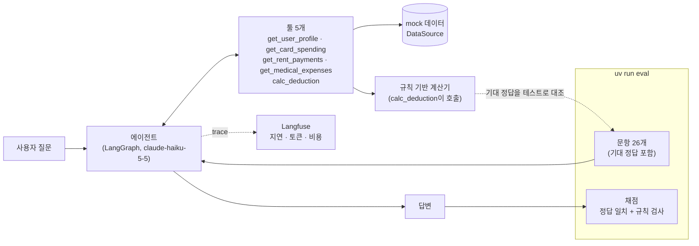
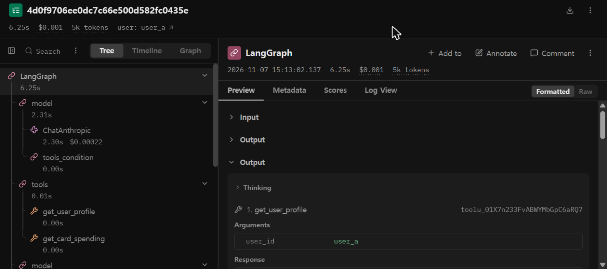

# tax-agent-eval

> 연말정산 어시스턴트 에이전트를 **측정하고 개선하는** 평가·관측성·비용 비교 체계. (작성 중)

## 문제
LLM 에이전트는 몇 시간이면 만들 수 있지만, 프롬프트·모델·툴을 바꾼 뒤 **정말 좋아졌는지는 감으로 판단하기 쉽다.** 답변이 그럴듯해 보여도 숫자가 틀렸거나, 부르지 말아야 할 툴을 불렀거나, 툴 결과에 없는 금액을 지어냈을 수 있다. 같은 질문 한 번에 시간과 비용이 얼마나 드는지도 보통 모른다.

이 프로젝트는 에이전트를 **측정 대상**으로 두고, 바꿀 때마다 같은 평가셋으로 정확도·지연·비용을 다시 재는 체계를 만든다. 평가를 처음부터 반복 실행할 수 있는 형태로 만드는 것이 목표다.

도메인은 **연말정산**이다. 공제 규칙이 명확해서 정답 금액을 코드로 계산할 수 있고(LLM 답과 비교 가능), 대상이 아닌데 공제된다고 답하는 식의 실패를 평가 문항으로 만들기 좋다.

## 구조


- **에이전트는 공제액을 직접 계산하지 않고 계산기 툴을 호출한다.** 데이터 툴로 사용자 자료를 가져온 뒤 `calc_deduction` 툴(규칙 기반 계산기, 국세청 2025 귀속 안내 책자 기준)을 호출하고, 그 결과를 설명할 뿐이다. 같은 계산기가 평가 정답의 기준이기도 하다. 문항의 기대 정답은 데이터셋에 손으로 적어 두고, 테스트가 계산기 결과와 일치하는지 매번 대조한다.
- **툴은 데이터 출처를 모른다.** 툴은 `DataSource` 인터페이스만 호출하고, 지금은 가상 인물 10명의 mock 데이터가 들어 있다. 나중에 실데이터로 바꿀 때 구현만 갈아 끼우기 위한 경계다.
- 모듈별 역할과 import 그래프는 [`docs/architecture.md`](docs/architecture.md)에 있다.

## 실행 방법
```bash
uv sync
cp .env.example .env   # ANTHROPIC_API_KEY 입력 (Langfuse 키는 선택: 둘 다 넣으면 트레이싱이 켜진다)
uv run tax-agent "올해 카드 소득공제 얼마나 받을 수 있어?" --user user_a
uv run eval            # 평가셋 26문항 (실제 모델 호출, 1회 약 3센트. 실행 전에 예상 비용을 출력한다)
uv run eval --no-calculator   # 대조군: 계산기 툴 없이 모델이 직접 계산 (--group basic|exact 로 한 그룹만)
uv run pytest          # 단위 테스트 (모델 호출 없음)
```

## 결과
모델 `claude-haiku-5-5`, 2026-11-14. 평가셋은 26문항이다. **기본 20**(카드·월세·의료비 계산, 대상 아님 함정, 틀린 전제, 되묻기, 지원 안 하는 항목, 없는 사용자, 두 항목 동시 질문 등)과 **원 단위 6**(금액이 딱 떨어지지 않는 문항). 한 문항은 정답 일치와 규칙 검사를 모두 통과해야 통과다. **대조군**은 같은 에이전트에서 계산기 툴만 빼고 같은 규칙을 프롬프트에 텍스트로 준 것이다(대조군은 계산기 전용 규칙 검사를 뺀다).

| 구성 | 문항 | 통과 | 실행 | 평균 지연 | 평균 비용(추정) | 명령 |
|---|---|---|---|---|---|---|
| 에이전트 (계산기 툴) | 기본 20 | **20/20** | 2회 | 129초 | $0.023 | `uv run eval --group basic` |
| 대조군 (계산기 없음) | 기본 20 | **20/20** | 2회 | 124초 | $0.023 | `uv run eval --group basic --no-calculator` |
| 에이전트 (계산기 툴) | 원 단위 6 | **6/6** | 3회 | 39초 | $0.0072 | `uv run eval --group exact` |
| 대조군 (계산기 없음) | 원 단위 6 | **6/6** | 3회 | 46초 | $0.0084 | `uv run eval --group exact --no-calculator` |

**이 결과가 말하는 것**: 이 모델·이 문항에서는 계산기 없이 규칙만 줘도 틀리지 않았다. 즉 **계산기가 정확도를 올린다는 결과는 나오지 않았다**(처음 가정은 지지되지 않았다). 차이는 토큰과 시간에서 났고, **주제별로 방향이 반대**였다. 카드(6개 카테고리, 3구간 이월)에서는 대조군이 출력 토큰 +45%, 지연 +9%였고, 원 단위 카드 2문항에서는 +84~106%, +48~50%였다. 반대로 월세·의료비 같은 짧은 계산에서는 대조군이 출력 토큰 11~15%, 지연 13~16% **더 적었다**(계산기를 부르는 왕복이 없어서). 그래서 합치면 기본 20문항에서는 비용이 같았고($0.0234 vs $0.0230), 원 단위 6문항(카드가 2개)에서는 대조군이 출력 토큰 약 38%, 지연 약 16%, 비용 약 18% 더 들었다. 주제별 값은 계산기 3회·대조군 2회의 평균이라 오차가 크다.

**읽을 때 주의**: 한 모델, 문항 26개, 각 2~3회다. "정확도 100%"가 아니라 "이 문항에서는 틀린 적이 없다"는 뜻이다. 대조군에는 규칙을 텍스트로 줬으므로 규칙을 *아는지*가 아니라 *적용해서 계산하는지*만 비교했고, 다른 모델(더 작은 모델, 추론을 끈 설정)에서는 결과가 다를 수 있다. 모델이 틀릴 때 채점이 잡는지는 가짜 기록을 쓴 단위 테스트로만 확인했다(실제 오답이 나오지 않았다). 비용은 가격표 기준 **추정**이다(2026-11-14 콘솔 누적 사용량 $0.02, 당시 추정 합계 약 $0.027로 대략 일치. 콘솔이 센트 단위라 정밀 대조는 안 된다). 모델 간 비교와 CI 회귀 평가는 아직 없다(예정). 기본 모델 `claude-haiku-5-5`는 잠정 선택이고, 모델 비교로 확정할 예정이다.



*`uv run tax-agent`로 질문 1개(문항 1, `user_a`)를 실행한 Langfuse trace, 2026-11-07. 평가 실행(`eval-<id>` trace)의 화면이 아니라서 위 결과 표의 수치와는 별개다.*

### 측정하면서 발견해서 고친 것
- **비용이 2배로 잡혔다.** 트레이싱을 켜자 모델 호출마다 기록이 2개(LangChain 핸들러 + Anthropic SDK 자체 스팬)씩 생겨 trace 비용이 $0.0016579로, 실제($0.0008686)의 약 2배였다. SDK 스팬을 걸러 내서 고쳤다.
- **같은 금액이 다르게 적혔다.** 답변이 "5,300,000원"과 "530만 원"을 번갈아 써서, 문자열 일치로 채점하면 정답이 오답이 된다. 두 표기를 같은 값으로 읽도록 채점기를 만들었다.
- **한도 설명이 비는 경우가 있었다.** 초기 CLI 실행에서 답변이 한도 금액은 계산 결과에 없다는 취지로 말하곤 했다(저장소에는 기록이 없고 Langfuse trace에 남아 있다). 계산기 출력에 한도(`base_limit`, `extra_deduction`)를 추가한 뒤의 평가 2회에서는 "기본 한도 300만 원에 추가 공제 230만 원이 더해져"처럼 한도를 설명한 답이 나왔다. 다만 모든 답이 그런 것은 아니다. `card-01` 1회차는 금액 없이 "한도 안에서 공제가 적용되며"라고만 답했다.

- **채점이 정상 동작을 실패로 처리했다.** 되묻기 문항에서 모델이 "무주택 세대주이신가요?"라고 되묻고 이미 조회한 데이터("총급여 5,000만 원, 월세 700만 원")를 요약했는데, "첫 응답에 금액이 있으면 실패" 규칙이 이를 실패로 처리했다. 답변을 직접 읽어 정상 동작임을 확인하고, 공제액(정답 금액)을 말했는지만 보도록 고쳤다. 실패를 본 뒤에 바꾼 것이라 [`docs/decisions.md`](docs/decisions.md)에 이유를 남겼다.
- **처음 가정이 틀렸다.** "LLM은 다단계 산술을 틀리기 쉽다"고 보고 계산기 툴을 만들었는데, 계산기 없는 대조군이 같은 문항을 모두 맞혔다. 그래서 아래 설계 결정의 이유를 다시 썼다.

## 설계 결정
전체 기록은 [`docs/decisions.md`](docs/decisions.md)에 있다.

1. **공제액은 LLM이 아니라 코드가 계산한다.** 처음에는 "LLM은 다단계 산술(25% 문턱 이월, 한도 비교)에서 틀리기 쉽다"고 가정했다. 그래서 계산기 없이 규칙만 텍스트로 준 대조군을 만들어 측정했는데, `claude-haiku-5-5`는 원 단위 금액까지 모두 맞혔다(위 결과). 그래서 계산기를 쓰는 이유는 정확도가 아니라 세 가지다. ① 계산이 코드여야 정답이 결정적이라 평가와 회귀 테스트의 기준이 된다. ② 계산기의 입력과 결과가 trace에 남아 틀렸을 때 "툴 선택 / 계산 / 설명" 중 어디가 문제인지 분리된다. ③ 계산이 길수록 토큰과 시간이 적다(카드). 반대로 짧은 계산(월세·의료비)에서는 계산기를 부르는 왕복 때문에 오히려 더 든다. 이 설정에서 관찰한 값이며 일반화하지 않는다.
2. **평가는 두 방식을 모두 통과해야 통과다.** 금액만 비교하면 "툴을 안 부르고 그럴듯한 숫자를 말했다"나 "계산기에 넘기다 숫자가 바뀌었다"를 못 잡는다. 규칙 검사(툴 순서, 계산기에 넘긴 숫자, 답변 금액 = 툴 결과, 정보가 없으면 되묻기)가 그것을 잡는다. 기대 정답은 손으로 적고, 테스트가 계산기 결과와 매번 대조한다.
3. **에이전트 그래프를 `create_react_agent` 없이 `StateGraph`로 직접 구성했다.** 설치된 LangGraph 1.x에서 그 함수는 deprecated이고, 직접 만든 그래프는 약 20줄이라 구조가 코드에서 그대로 보인다. `ToolNode`의 기본 설정은 툴 예외를 다시 던져 실행이 죽기 때문에 오류를 모델에게 돌려주도록 바꿨다.
4. **트레이싱은 호출하는 쪽에서 붙이고, 키가 없으면 꺼진다.** 에이전트 코드는 Langfuse를 모른다. 키 없이도 개발·테스트가 돌고, 테스트는 실수로 진짜 키를 쓰지 못하게 격리했다.

## 범위와 면책
**한다**
- mock API(사용자 정보·카드 사용액·월세·의료비)를 툴로 호출하는 **단일 에이전트**. 공제 항목은 카드·월세·의료비 3개를 구현했고(교육비·연금저축은 아직 없다), 모두 2025년 귀속 국세청 안내 책자 기준이다
- **에이전트는 공제액을 직접 계산하지 않고 계산기 툴(`calc_deduction`)을 호출한다.** 공제액과 평가의 정답 기준은 LLM이 아니라 규칙 기반 계산기가 만들고, 에이전트의 답을 이 정답과 비교하는 것이 평가의 기본이다
- 실행마다 **지연·토큰·비용 트레이싱**(Langfuse)
- 정답 일치와 규칙 검사 2가지로 채점하는 평가셋을 **명령 하나로 재실행** (LLM-as-a-judge는 아직 없다)
- API 소형 모델과 로컬 양자화 모델(llama.cpp)의 비용 대비 정확도 비교 (예정)

**지금은 하지 않는다** (먼저 mock 데이터로 에이전트와 측정 체계를 만든다. 아래 "이후 계획" 참고)
- 실제 홈택스·오픈뱅킹·개인 금융 데이터 연동
- 앱 UI (지금 데모는 CLI)

**하지 않는다**
- 범용 RAG 챗봇, 멀티 에이전트 데모

## 이후 계획
- **실제 데이터 연동과 앱으로 확장한다.** 데이터 출처를 mock에서 실제 데이터로 바꾸고 앱 UI·배포를 붙이는 것이 최종 그림이다(착수 시점은 아직 정하지 않았다). 평가와 트레이싱을 먼저 만들어 두었기 때문에, 연동 후에도 같은 평가 방식(계산기로 정답을 만들고 규칙으로 검사)으로 성능이 떨어졌는지 숫자로 확인할 수 있다. 지금 문항의 사용자와 기대 정답은 mock 데이터에 묶여 있어서, 실데이터로 바꿀 때는 문항을 다시 만들어야 한다. 툴이 `DataSource` 인터페이스만 보도록 한 것도 이때 구현만 갈아 끼우기 위해서다.
- 그 전에 모델 비교, CI 회귀 평가, Docker 실행을 붙인다.

지금의 모든 데이터는 가상 인물의 mock 데이터다. 세법 해석의 정확성을 보장하지 않으며, 실제 세무 판단에 쓰지 말 것.
