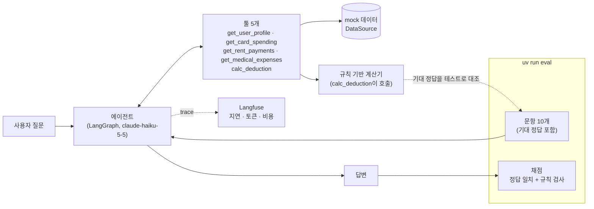
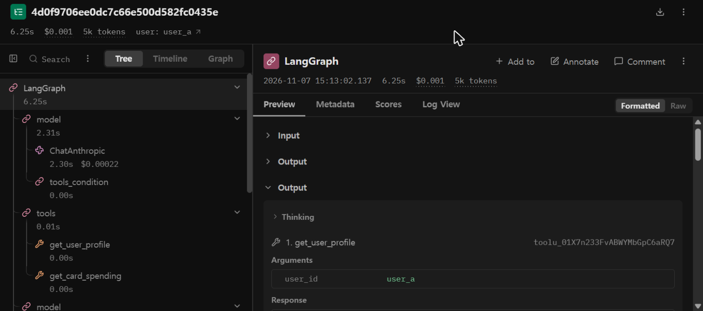

# tax-agent-eval

> 연말정산 어시스턴트 에이전트를 **측정하고 개선하는** 평가·관측성·비용 비교 체계. (작성 중)

## 문제
LLM 에이전트는 몇 시간이면 만들 수 있지만, 프롬프트·모델·툴을 바꾼 뒤 **정말 좋아졌는지는 감으로 판단하기 쉽다.** 답변이 그럴듯해 보여도 숫자가 틀렸거나, 부르지 말아야 할 툴을 불렀거나, 툴 결과에 없는 금액을 지어냈을 수 있다. 같은 질문 한 번에 시간과 비용이 얼마나 드는지도 보통 모른다.

이 프로젝트는 에이전트를 **측정 대상**으로 두고, 바꿀 때마다 같은 평가셋으로 정확도·지연·비용을 다시 재는 체계를 만든다. 평가를 처음부터 반복 실행할 수 있는 형태로 만드는 것이 목표다.

도메인은 **연말정산**이다. 공제 규칙이 명확해서 정답 금액을 코드로 계산할 수 있고(LLM 답과 비교 가능), 대상이 아닌데 공제된다고 답하는 식의 실패를 평가 문항으로 만들기 좋다.

## 구조


- **에이전트는 공제액을 직접 계산하지 않고 계산기 툴을 호출한다.** 데이터 툴로 사용자 자료를 가져온 뒤 `calc_deduction` 툴(규칙 기반 계산기, 국세청 2025 귀속 안내 책자 기준)을 호출하고, 그 결과를 설명할 뿐이다. 같은 계산기가 평가 정답의 기준이기도 하다. 문항의 기대 정답은 데이터셋에 손으로 적어 두고, 테스트가 계산기 결과와 일치하는지 매번 대조한다.
- **툴은 데이터 출처를 모른다.** 툴은 `DataSource` 인터페이스만 호출하고, 지금은 가상 인물 10명의 mock 데이터가 들어 있다. 나중에 실데이터로 바꿀 때 구현만 갈아 끼우기 위한 경계다.
- 모듈별 역할과 import 그래프는 [`docs/architecture.md`](docs/architecture.md)에 있다.

## 실행 방법
```bash
uv sync
cp .env.example .env   # ANTHROPIC_API_KEY 입력 (Langfuse 키는 선택: 둘 다 넣으면 트레이싱이 켜진다)
uv run tax-agent "올해 카드 소득공제 얼마나 받을 수 있어?" --user user_a
uv run eval            # 평가셋 10문항 (실제 모델 호출, 1회 약 1센트. 실행 전에 예상 비용을 출력한다)
uv run pytest          # 단위 테스트 (모델 호출 없음)
```

## 결과
| 지표 | 값 | 측정 조건 |
|---|---|---|
| 평가셋 통과 | **10/10**, 2회 실행 모두 (정답 일치 10/10 · 규칙 10/10) | `uv run eval`, 10문항(질문 11개), `claude-haiku-5-5`, 2026-11-10 |
| 비용 | 1회 약 **$0.012** (추정 $0.0118, $0.0119) | 같은 두 실행. 토큰 입력/출력은 1회차 76,351/8,355, 2회차 75,535/8,785. 가격표 기준 **추정**이며 콘솔 청구액과의 대조는 아직 안 했다 |
| 지연 | 문항당 약 5~11초, 10문항 합계 약 **72초** | 같은 실행(71.3초, 73.2초) |

한 문항은 **정답 일치와 규칙 검사를 모두 통과해야** 통과다. 문항은 카드 6(되묻기 1 포함)·월세 2·의료비 2이다.

**읽을 때 주의**: 문항이 10개이고 각 1회씩, 비교적 쉬운 문항이라 "정확도 100%"가 아니라 "이 10문항은 두 번 다 통과했다"는 뜻이다. 모델이 틀릴 때 채점이 잡는지는 가짜 기록을 쓴 단위 테스트로만 확인했다. 모델 간 비용·지연 비교와 CI 회귀 평가는 아직 없다(예정). 기본 모델 `claude-haiku-5-5`는 잠정 선택이고, 모델 비교로 확정할 예정이다.



*`uv run tax-agent`로 질문 1개(문항 1, `user_a`)를 실행한 Langfuse trace, 2026-11-07. 평가 실행(`eval-<id>` trace)의 화면이 아니라서 위 결과 표의 수치와는 별개다.*

### 측정하면서 발견해서 고친 것
- **비용이 2배로 잡혔다.** 트레이싱을 켜자 모델 호출마다 기록이 2개(LangChain 핸들러 + Anthropic SDK 자체 스팬)씩 생겨 trace 비용이 $0.0016579로, 실제($0.0008686)의 약 2배였다. SDK 스팬을 걸러 내서 고쳤다.
- **같은 금액이 다르게 적혔다.** 답변이 "5,300,000원"과 "530만 원"을 번갈아 써서, 문자열 일치로 채점하면 정답이 오답이 된다. 두 표기를 같은 값으로 읽도록 채점기를 만들었다.
- **한도 설명이 비는 경우가 있었다.** 초기 CLI 실행에서 답변이 한도 금액은 계산 결과에 없다는 취지로 말하곤 했다(저장소에는 기록이 없고 Langfuse trace에 남아 있다). 계산기 출력에 한도(`base_limit`, `extra_deduction`)를 추가한 뒤의 평가 2회에서는 "기본 한도 300만 원에 추가 공제 230만 원이 더해져"처럼 한도를 설명한 답이 나왔다. 다만 모든 답이 그런 것은 아니다. `card-01` 1회차는 금액 없이 "한도 안에서 공제가 적용되며"라고만 답했다.

## 설계 결정
전체 기록은 [`docs/decisions.md`](docs/decisions.md)에 있다.

1. **공제액은 LLM이 아니라 코드가 계산한다.** 다단계 산술(25% 문턱 이월, 한도 비교)은 LLM이 틀리기 쉽고, 계산이 코드여야 정답이 결정적이라 정답 일치 평가와 회귀 테스트가 가능하다. 틀렸을 때 "툴 선택 / 계산 / 설명" 중 어디가 문제인지도 trace에서 분리된다.
2. **평가는 두 방식을 모두 통과해야 통과다.** 금액만 비교하면 "툴을 안 부르고 그럴듯한 숫자를 말했다"나 "계산기에 넘기다 숫자가 바뀌었다"를 못 잡는다. 규칙 검사(툴 순서, 계산기에 넘긴 숫자, 답변 금액 = 툴 결과, 정보가 없으면 되묻기)가 그것을 잡는다. 기대 정답은 손으로 적고, 테스트가 계산기 결과와 매번 대조한다.
3. **에이전트 그래프를 `create_react_agent` 없이 `StateGraph`로 직접 구성했다.** 설치된 LangGraph 1.x에서 그 함수는 deprecated이고, 직접 만든 그래프는 약 20줄이라 구조가 코드에서 그대로 보인다. `ToolNode`의 기본 설정은 툴 예외를 다시 던져 실행이 죽기 때문에 오류를 모델에게 돌려주도록 바꿨다.
4. **트레이싱은 호출하는 쪽에서 붙이고, 키가 없으면 꺼진다.** 에이전트 코드는 Langfuse를 모른다. 키 없이도 개발·테스트가 돌고, 테스트는 실수로 진짜 키를 쓰지 못하게 격리했다.

## 범위와 면책
**한다**
- mock API(사용자 정보·카드 사용액·월세·의료비)를 툴로 호출하는 **단일 에이전트**. 공제 항목은 카드·월세·의료비 3개를 구현했고(교육비·연금저축은 아직 없다), 모두 2025년 귀속 국세청 안내 책자 기준이다
- **에이전트는 공제액을 직접 계산하지 않고 계산기 툴(`calc_deduction`)을 호출한다.** 공제액과 평가의 정답 기준은 LLM이 아니라 규칙 기반 계산기가 만들고, 에이전트의 답을 이 정답과 비교하는 것이 평가의 기본이다
- 실행마다 **지연·토큰·비용 트레이싱**(Langfuse)
- 정답 일치와 규칙 검사 2가지로 채점하는 평가셋을 **명령 하나로 재실행** (LLM-as-a-judge는 아직 없다)
- API 소형 모델과 로컬 양자화 모델(llama.cpp)의 비용 대비 정확도 비교 (예정)

**지금은 하지 않는다** (먼저 mock 데이터로 에이전트와 측정 체계를 만든다. 아래 "이후 계획" 참고)
- 실제 홈택스·오픈뱅킹·개인 금융 데이터 연동
- 앱 UI (지금 데모는 CLI)

**하지 않는다**
- 범용 RAG 챗봇, 멀티 에이전트 데모

## 이후 계획
- **실제 데이터 연동과 앱으로 확장한다.** 데이터 출처를 mock에서 실제 데이터로 바꾸고 앱 UI·배포를 붙이는 것이 최종 그림이다(착수 시점은 아직 정하지 않았다). 평가와 트레이싱을 먼저 만들어 두었기 때문에, 연동 후에도 같은 평가 방식(계산기로 정답을 만들고 규칙으로 검사)으로 성능이 떨어졌는지 숫자로 확인할 수 있다. 지금 문항의 사용자와 기대 정답은 mock 데이터에 묶여 있어서, 실데이터로 바꿀 때는 문항을 다시 만들어야 한다. 툴이 `DataSource` 인터페이스만 보도록 한 것도 이때 구현만 갈아 끼우기 위해서다.
- 그 전에 모델 비교, CI 회귀 평가, Docker 실행을 붙인다.

지금의 모든 데이터는 가상 인물의 mock 데이터다. 세법 해석의 정확성을 보장하지 않으며, 실제 세무 판단에 쓰지 말 것.
