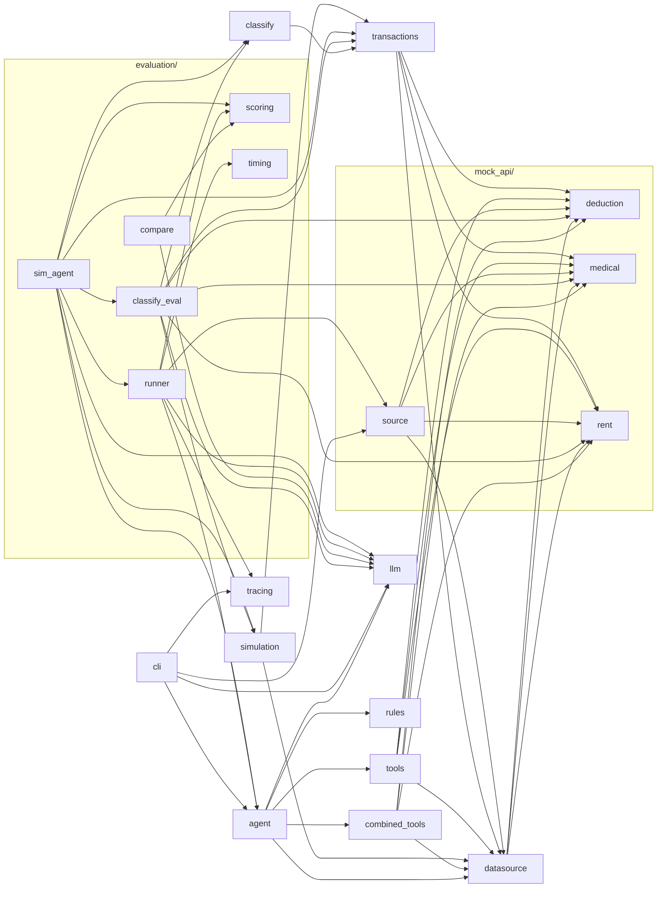
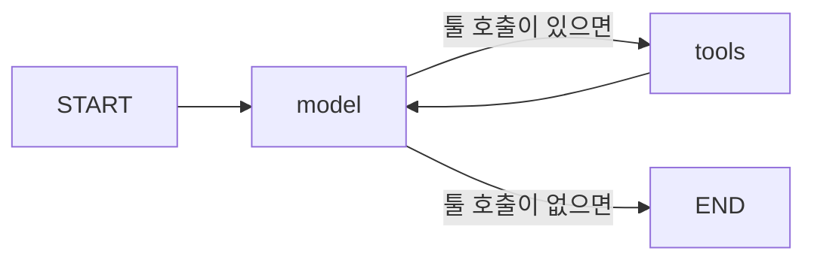

# 모듈 구조

> 이 문서의 **의존 그래프**(`gen:start`~`gen:end` 사이)만 `uv run python scripts/gen_arch.py`가 자동으로 다시 그린다. 나머지 설명은 손으로 쓴다.
> 새 모듈을 만들면 아래 "모듈별 역할" 표에 한 줄 추가한다 (빠뜨리면 스크립트가 알려 준다).

## 한눈에 보기

코드는 여섯 덩어리다.

1. **툴** (`tools`, `combined_tools`): 에이전트가 호출하는 함수들. 기본 에이전트는 `combined_tools`의 툴 1개(조회·데이터·계산을 한 번에)를 쓰고, `tools`의 단계별 툴 5개는 비교용 변형(`calculator`)이 쓴다.
2. **데이터 소스** (`datasource` + `mock_api.source` + `transactions`): 툴이 데이터를 가져오는 곳. 인터페이스, mock 구현, 본인 거래 내역에서 공제 입력을 만드는 구현으로 나뉜다.
3. **규칙 계산기** (`mock_api.deduction`·`mock_api.rent`·`mock_api.medical`): 카드 소득공제, 월세 세액공제, 의료비 세액공제를 규칙으로 계산한다. 평가의 정답을 만드는 코드이기도 하다.
4. **에이전트** (`agent` + `llm` + `cli`): LangGraph로 만든 모델-툴 루프(`agent`), LLM을 만드는 한 곳(`llm`), 명령줄 진입점(`cli`).
5. **트레이싱** (`tracing`): 실행을 Langfuse로 보낸다. 키가 없으면 꺼져 있다.
6. **평가** (`evaluation.scoring` + `evaluation.runner`): 문항 32개(기본 20 + 원 단위 6 + 길이 스윕 6)를 실제 모델로 돌리고 채점한다. `uv run eval`, 대조군은 `uv run eval --no-calculator`, 통합 툴 에이전트는 `uv run eval --variant combined`, 저장된 결과의 비교는 `uv run eval-compare`, 합성 사용자로 거래 분류를 재는 것은 `uv run sim-eval`, 거래에서 에이전트 답까지 재는 것은 `uv run sim-agent`.

에이전트는 `build_agent(source, user_id)`로 만들고(기본은 통합 툴 변형), 어떤 데이터 소스를 쓸지는 호출하는 쪽이 넘긴다(아래 "어떻게 이어지나"). 실행은 `uv run tax-agent "질문" --user user_a`다. 실제 모델(`claude-haiku-5-5`)로 문항 1을 1회 돌려 `compute_deduction` 한 번에 5,300,000원(530만 원)이 나오는 것을 확인했다(2026-11-18, 토큰 입력/출력 2,433/968, 약 $0.0007, 7.5초. 처음 단계별 툴로 확인한 2026-11-07 값은 툴 3개, 4,095/942, 약 $0.0009, 6.8초). 1회 관찰이라 정확도 수치는 아니다. 테스트는 가짜 모델로 연결만 검증한다. 평가는 `uv run eval`이 `evals/dataset.jsonl`의 32문항을 실제 모델로 돌린다(아래 "평가 흐름").

## 의존 그래프

화살표 `A --> B`는 "A가 B를 import한다"는 뜻이다. 테스트와 `evals/`는 포함하지 않는다.

<!-- gen:start -->

<!-- gen:end -->

## 모듈별 역할

| 모듈 | 역할 | 상태 |
|---|---|---|
| `tools` | 에이전트가 부르는 함수 5개(`get_user_profile`, `get_card_spending`, `get_rent_payments`, `get_medical_expenses`, `calc_deduction`)를 `build_tools(source)`로 만든다. 데이터 소스는 인자로 받는다 | 구현됨 |
| `combined_tools` | `build_combined_tools(source)`: 툴 하나 `compute_deduction(user_id, item, gross_salary=None, homeless_household_head=None)`. 프로필 조회·데이터 조회·규칙 계산을 코드 안에서 다 하고 금액과 계산에 쓴 값(`inputs`)을 돌려준다. 총급여나 무주택 여부가 프로필에 없으면 `missing` 목록을 돌려줘서 에이전트가 되묻게 한다. 모델 호출을 줄이려는 변형(단계별 툴은 최소 3번, 이쪽은 2번)이고, 대신 모델이 숫자를 한 툴에서 다른 툴로 옮기는 일이 없어져 "숫자가 중간에 바뀌는" 실패는 재지 못한다 | 구현됨 |
| `transactions` | 본인 거래 내역으로 만드는 데이터 소스. `Transaction`(날짜·금액·가맹점·결제수단·분류), 연도별 합산(`card_spending`, `rent_payments`, `medical_expenses`), 분류가 안 된 거래 목록(`unclassified`), `TransactionDataSource`(`DataSource` 구현). 거래가 어디서 오든(카드사·은행 내보내기 파일, 나중에 API) 어댑터가 `Transaction`만 만들면 뒤는 같다. 분류 안 된 거래와 공제 제외 거래는 어디에도 세지 않는다(추측으로 분류하면 공제액이 조용히 바뀐다). 취소는 음수로 같은 칸을 줄인다. 아직 없는 것: 의료비를 카드로 낸 경우의 카드 중복 적용 여부, 기부금(계산기 없음), 파일 어댑터와 가맹점 분류. 테스트는 가상 거래만 쓴다 | 구현됨 (가상 거래로 검증, 실데이터 미사용) |
| `simulation` | 합성 사용자. `simulate_user(seed)`가 가상 사용자의 총급여·무주택 여부와 1년치 거래(가맹점 이름은 지어낸 것)를 **정답 분류와 함께** 만든다. `SimUser.unlabeled()`는 내보내기 파일처럼 분류를 지운 거래다. `obscure_rate`는 특수 분류(의료·교통·전통시장·문화·제외·월세) 중 가맹점 이름만으로는 알 수 없는 것("봄날 건강센터")의 비율이다. 단순화: 의료비는 전부 본인분, 의료비는 카드 사용액으로 중복 계산하지 않음, 제외 업종은 상식 기준이라 국세청 책자 대조가 필요함 | 구현됨 |
| `classify` | 거래 분류기. 분류기는 거래 목록을 받아 분류를 채워 돌려주는 함수다. `classify_rules`는 가맹점 이름의 키워드로 정하는 기준선(키워드가 없으면 카드·현금영수증은 일반, 이체는 분류 안 됨)이고, `LLMClassifier`는 서로 다른 (가맹점, 결제수단)마다 한 번 모델에게 묻고 기억한다. 답은 **줄 번호를 키로** 받는다(위치로 받으면 모델이 한 줄만 빼도 뒤가 전부 밀린다). 없거나 이상한 답은 분류 안 됨이다 | 구현됨 |
| `evaluation.classify_eval` | `uv run sim-eval [--classifier rules|llm] [--users 50] [--obscure 0.15]`: 합성 사용자들의 거래를 분류기에 넣어 분류 정확도(분류별 재현율, 가장 많이 틀린 쌍)와, 틀린 분류가 카드 공제·월세·의료비 공제액에 주는 오차(원)를 잰다. 모델은 `--classifier llm`일 때만 부르고 실행 전에 예상 비용을 출력한다 | 구현됨 |
| `evaluation.sim_agent` | `uv run sim-agent [--classifier rules|llm] [--users 20]`: 합성 사용자의 거래를 분류기로 라벨링하고 `TransactionDataSource`로 기본 에이전트에 붙여 카드·월세·의료비를 묻는다. 질문마다 T(정답 공제액), C(분류된 거래로 계산한 툴 값), A(에이전트가 답한 금액)를 비교해 오류를 층별로 가른다(분류 오류 = C와 T, 에이전트 오류 = A와 C). 사용자 정보는 프로필에 있어 되묻는 일이 없어야 한다. 모델은 에이전트 질문마다 부르고 실행 전에 예상 비용을 출력한다 | 구현됨 |
| `datasource` | `DataSource` 인터페이스(Protocol)와 `UserProfile`. 툴과 데이터 출처 사이의 경계 | 구현됨 |
| `mock_api.source` | `MockDataSource`: 가상 사용자 29명(`user_a`~`user_y`, `user_sw1`~`user_sw6`)의 프로필·카드 사용액·월세·의료비. 사용자마다 평가 문항 하나를 위해 만들었다. 실연동 때 이 자리에 다른 구현이 들어온다 | 구현됨 (사용자 29명) |
| `mock_api.deduction` | `calc_card_deduction`: 카드 소득공제를 규칙으로 계산한다. `calc_deduction` 툴의 실체이자 평가의 정답 생성기. 국세청 2025 귀속 책자 133쪽 ⑥·136~138쪽 기준. 문턱 차감 순서와 한도 정보(`base_limit`, `extra_deduction`)까지 돌려준다 | 구현됨 (카드) |
| `mock_api.rent` | `calc_rent_credit`: 월세 세액공제. 총급여 8천만원 초과 또는 무주택 세대주가 아니면 대상 아님(`eligible=false`와 `reason`), 5,500만원 이하 17%·초과 15%, 월세 연 1,000만원 한도. 책자 202~203쪽 기준 | 구현됨 |
| `mock_api.medical` | `calc_medical_credit`: 의료비 세액공제. 총급여 3% 문턱을 '그 외 부양가족'(700만원 한도) 의료비부터 차감하고, 보험금으로 돌려받은 금액은 뺀다. 책자 173·176쪽 기준. 난임시술비·미숙아 구분은 범위 밖 | 구현됨 |
| `evaluation.scoring` | 채점 순수 함수. 금액 표기 정규화(`5,300,000원`·`530만 원`·`167만 8,011원`), 정답 일치(금액·0원·대상 아님·여러 금액·지원 안 함·사용자 없음)와 규칙 검사 11종(`tool_called`, `args_relayed`, `answer_uses_tool_amount`, `asks_question` …), 문항별 점수. 데이터셋은 단계별 에이전트 기준으로 쓰여 있어서, `specs_for(specs, variant)`가 대조군은 계산기 전용 검사를 빼고 통합 툴 에이전트는 검사를 `compute_deduction`용으로 바꾼다(프로필 조회·순서·숫자 전달 검사는 뺀다). 모델을 부르지 않아 단위 테스트가 된다 | 구현됨 |
| `evaluation.runner` | `uv run eval [--variant calculator|no_calculator|combined] [--no-calculator] [--group basic|exact|sweep]`: 데이터셋을 읽어 문항마다 에이전트를 만들고(다중 턴 지원) 실행·채점하고, 실행 전에 예상 비용을 출력하며, 결과를 `evals/results/<시각>.json`에 저장한다. 문항마다 Langfuse trace `eval-<id>`가 생기고, 추론 토큰·모델 호출 수·모델 시간도 함께 저장한다 | 구현됨 |
| `evaluation.timing` | `CallTimer`: LangChain 콜백으로 모델 호출 하나하나의 시간과 툴 호출 시간을 따로 잰다. 계산기를 부르는 왕복(모델 호출 추가)과 모델이 생각하는 시간을 가르기 위한 것이다 | 구현됨 |
| `evaluation.compare` | `uv run eval-compare [--since …] [--group …] [--raw]`: 저장된 결과를 모델·그룹별로 모아 계산기 에이전트를 기준으로 대조군·통합 툴 에이전트의 토큰·추론 토큰·모델 호출 수·시간·비용 변화율과 주제별 변화율을 보여 준다. 문항별 평균의 합이라 "그룹을 한 번 돌린 값"이다. 기본으로 저장된 최종 답변을 현재의 정답 일치 규칙으로 다시 판정한다(채점 정규식을 고친 뒤 옛 결과가 틀린 판정으로 남지 않게). 바뀐 판정은 출력 첫 줄에 나오고 `--raw`는 저장된 판정을 그대로 쓴다. 툴 호출 규칙 검사는 기록이 없어 다시 돌리지 않는다 | 구현됨 |
| `agent` | `build_agent(source, user_id, model, variant="calculator")`: 모델 노드와 툴 노드가 도는 LangGraph 그래프를 만든다. `variant`는 셋 중 하나다. `calculator`는 단계별 툴과 계산기, `no_calculator`는 계산기 툴을 빼고 규칙을 프롬프트에 텍스트로 주는 대조군, `combined`는 `compute_deduction` 툴 하나다. `ask(agent, question)`은 질문 하나를 실행하고 메시지 전체를 돌려준다. 한 질문당 최대 12 스텝. `history`로 후속 질문을 이어 갈 수 있고(되묻기 문항), `token_totals()`와 `reasoning_tokens()`도 여기 있다 | 구현됨 (평가셋 32문항으로 확인) |
| `llm` | `get_model()`: LLM을 만드는 유일한 곳. 모델 이름은 인자 → 환경변수 `TAX_AGENT_MODEL` → 기본값 `claude-haiku-5-5` 순으로 정한다. `estimate_cost_usd()`와 가격표도 여기 있다 | 구현됨 |
| `rules` | 세 공제의 규칙을 영어 텍스트(`RULES_TEXT`)로 적은 것. 대조군 프롬프트에만 쓰인다. 숫자와 반올림 규칙이 계산기와 같은지 `tests/test_rules.py`가 지킨다 | 구현됨 |
| `cli` | `tax-agent` 명령. `MockDataSource`를 골라 `build_agent`에 넘기고, 질문 하나를 실행해 툴 호출 순서·답변·소요 시간·토큰·추정 비용을 출력한다 | 구현됨 (실제 모델로 문항 1을 1회 확인) |
| `tracing` | `trace()`가 Langfuse 콜백 핸들러를 만들어 `ask(callbacks=...)`로 넘기게 하고, `flush()`가 종료 전에 전송한다. `LANGFUSE_PUBLIC_KEY`·`LANGFUSE_SECRET_KEY`가 둘 다 있을 때만 켜지고, 아니면 아무것도 import하지 않는다. `agent`는 이 모듈을 모른다. Anthropic SDK가 따로 내보내는 중복 스팬은 걸러 낸다(안 걸러 내면 비용·토큰이 2배로 잡힌다) | 구현됨 (Langfuse API 조회로 확인) |

## 에이전트 그래프 (`agent.py`)

`model`이 툴을 부르면 `tools`가 실행하고 그 결과를 들고 다시 `model`로 돌아온다. 툴 호출 없이 답이 나오면 끝난다. 툴이 예외를 던져도 실행이 죽지 않고 오류 메시지가 `model`에게 전달된다. 이 그림은 손으로 그렸으므로 `agent.py`의 그래프를 바꾸면 같이 고친다.

## 데이터 흐름: 평가 문항 1 (사용자 `user_a`, "카드 소득공제 얼마나 받아?")

기본 에이전트(통합 툴)는 `compute_deduction("user_a", "card")` 한 번을 부르고, 그 안에서 아래 세 단계가 코드로 이어진다. 모델 호출은 툴 요청과 결과 설명 2번이다. 단계별 변형(`calculator`)은 모델이 아래 세 단계를 직접 차례로 부른다.

1. `get_user_profile("user_a")` → 총급여 68,000,000원
2. `get_card_spending("user_a", 2025)` → 신용·체크·현금영수증·전통시장·대중교통·문화체육, 6개 카테고리(서로 겹치지 않음)
3. `calc_deduction("card", 총급여, 사용액)` → 공제액 5,300,000원 (530만원)

LLM은 어떤 툴을 언제 부를지 판단하고 결과를 설명할 뿐, 금액은 계산하지 않는다 (`decisions.md` 2026-10-28). 단계별 툴 3개가 맞게 동작하는지는 `tests/test_tools.py`가, 통합 툴이 같은 금액을 돌려주는지는 `tests/test_combined_tools.py`가, 에이전트 그래프가 호출을 실제로 연결해 주는지는 `tests/test_agent.py`(가짜 모델)가 확인한다. **실제 모델이 이 순서를 스스로 따르는지**는 테스트가 아니라 블록 B의 실행과 이후 평가셋이 확인한다.

## 평가 흐름 (`uv run eval`)

1. `evals/dataset.jsonl`에서 문항을 읽는다. 문항은 사용자, 질문(1~2턴), 기대 정답, 규칙 검사 목록으로 이루어진다.
2. 실행 전에 예상 비용을 출력한다.
3. 문항마다 그 사용자용 에이전트를 만들어 질문을 차례로 던진다(`ask`, 후속 질문은 `history`로 이어 감). 실행은 Langfuse trace `eval-<id>`로 남는다.
4. `scoring`이 메시지 기록을 두 가지로 채점한다. **정답 일치**: 최종 답변이 기대 금액(또는 "0원", "대상 아님")을 말하는가. **규칙**: 툴 호출 순서, 계산기에 넘긴 숫자가 데이터 툴 결과와 같은가, 답변 금액이 계산기 결과와 같은가, 되묻기 문항에서 필요한 정보를 받기 전에 계산하거나 공제액을 말하지 않았는가(이미 조회한 데이터를 되풀이하는 것은 허용). 두 방식을 모두 통과해야 문항 통과다.
5. 요약(정답 일치·규칙·전체 통과, 토큰, 시간, 추정 비용)을 출력하고 결과를 JSON으로 저장한다.

기대 정답은 데이터셋에 손으로 적어 두고, `tests/test_eval_dataset.py`가 계산기 결과와 같은지 매번 확인한다. 정답과 계산기가 어긋나면 테스트가 깨진다.

**통합 툴 에이전트** (`--variant combined`): `build_agent(..., variant="combined")`는 툴을 `compute_deduction` 하나만 주고 같은 행동 규칙(되묻기, 대상 아님, 숫자 지어내지 않기)을 프롬프트에 적는다. 단계별 에이전트가 프로필→데이터→계산기로 모델을 세 번 이상 부르는 것을 두 번(툴 요청, 결과 설명)으로 줄이는 변형이다. 채점은 같은 정답 일치에 검사를 바꿔 적용한다: "프로필을 조회했는가"는 "`compute_deduction`을 불렀는가"로, "계산기를 아직 안 불렀는가"는 "금액이 든 계산 결과를 아직 안 받았는가"(`no_deduction_result`)로 바뀌고, 호출 순서와 숫자 전달 검사는 단계가 없어 뺀다.

**대조군** (`--no-calculator`): `build_agent(..., variant="no_calculator")`로 같은 에이전트에서 `calc_deduction`만 빼고 같은 행동 규칙에 세 공제의 규칙 텍스트(`rules`)를 더한다. 모델이 규칙을 알아도 직접 계산하면 틀리는지를 재는 용도다. 채점은 같은 정답 일치에 계산기 전용이 아닌 규칙 검사만 적용한다. 문항은 `basic`(20)과 `exact`(원 단위 6) 그룹으로 나뉘어 `--group`으로 따로 돌릴 수 있고, 요약에도 그룹별로 나온다.

## 의존 방향과 규칙

- 방향은 `tools` → `datasource` ← `mock_api.source`다. `tools`는 `MockDataSource`를 import하지 않는다.

### `tools`와 데이터 소스는 어떻게 이어지나

연결은 import가 아니라 **호출하는 쪽이 객체를 인자로 넘기는 것**으로 이루어진다.

1. **자리 선언 (`tools.py`)**: `build_tools(source: DataSource)`는 `source` 자리에 올 것의 모양(메서드 `get_user_profile`, `get_card_spending`)만 적어 둔다. `DataSource`는 그 자리의 라벨이지, `tools`가 무언가를 넣는 것이 아니다.
2. **구현 선택 (호출하는 쪽)**: 어떤 구현을 쓸지는 호출부가 정해 `build_tools(MockDataSource())`처럼 넘긴다. 실제 실행의 호출부는 `cli.py`(`build_agent(MockDataSource(), ...)`)이고, 테스트들도 각자 구현을 골라 넘긴다. `build_agent(source, ...)`도 같은 방식으로 `source`를 받아 `build_tools`에 넘기므로, 에이전트도 데이터 출처를 모른다. `MockDataSource`가 코드에 등장하는 곳은 호출부와 `mock_api.source` 자신뿐이다.
3. **실제 연결 (실행할 때)**: `tools`가 `source.get_card_spending(...)`을 부르면, 넘어온 객체에서 이름이 같은 메서드가 실행된다. `MockDataSource`는 `DataSource`를 상속하지 않고, 메서드 이름과 인자가 같다는 것만으로 연결된다 (덕 타이핑).
4. **`DataSource`(Protocol)의 역할**: 실행할 때는 아무것도 검사하지 않는 규격서다. Pylance 같은 타입 검사기가 편집 중에 모양이 안 맞는 객체를 짚어 주고, 읽는 사람에게 "소스를 바꾸려면 이 메서드 두 개를 만들면 된다"를 알려 준다. 메서드가 없는 객체를 넘기면 `build_tools` 호출 때가 아니라 그 메서드를 실제로 부르는 순간 `AttributeError`가 난다.

`mock_api.source`는 `UserProfile` 타입을 쓰려고 `datasource`를 import하지만, "`MockDataSource`는 `DataSource`다"라는 선언(상속이나 등록)은 어디에도 없다.

### 규칙과 한계

- 실연동으로 바꿀 때는 같은 이름의 메서드를 가진 새 클래스를 만들고 호출부를 `build_tools(RealDataSource())`로 바꾸면 `tools`는 그대로다 (`decisions.md` 2026-10-28).
- **알려진 어긋남**: `datasource`와 `tools`가 `mock_api`의 계산기(`deduction`·`rent`·`medical`)를 import한다. 계산기와 그 입력 타입은 데이터가 아니라 규칙이라 실연동 후에도 남는데, 폴더 이름이 `mock_api/`라 어색하다. 실연동 전에 `mock_api/` 밖으로 옮기는 것이 후보이고, 아직 옮기지 않았다.
- 이 경계를 강제하는 타입 검사기는 없다. `tests/test_tools.py`의 가짜 소스 테스트가 지킨다.
