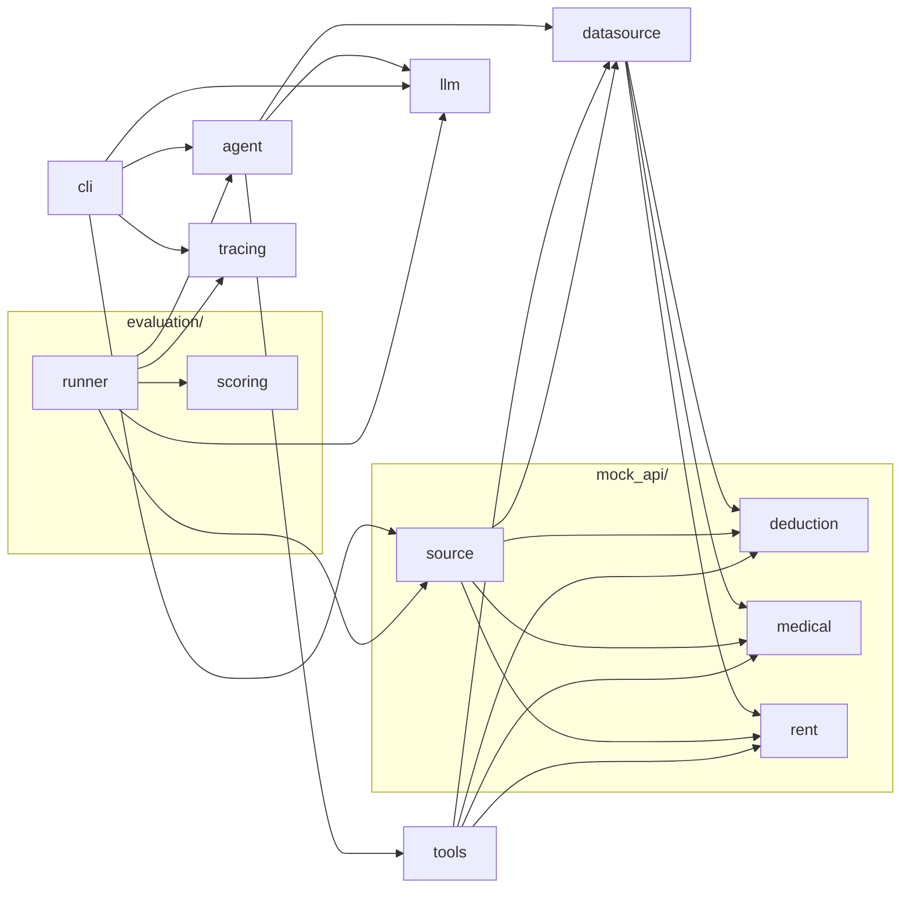
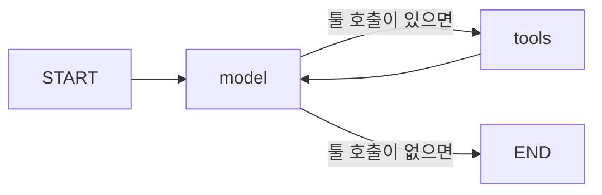

# 모듈 구조

> 이 문서의 **의존 그래프**(`gen:start`~`gen:end` 사이)만 `uv run python scripts/gen_arch.py`가 자동으로 다시 그린다. 나머지 설명은 손으로 쓴다.
> 새 모듈을 만들면 아래 "모듈별 역할" 표에 한 줄 추가한다 (빠뜨리면 스크립트가 알려 준다).

## 한눈에 보기

코드는 여섯 덩어리다.

1. **툴** (`tools`): 에이전트가 호출하는 함수들.
2. **데이터 소스** (`datasource` + `mock_api.source`): 툴이 데이터를 가져오는 곳. 인터페이스와 mock 구현으로 나뉜다.
3. **규칙 계산기** (`mock_api.deduction`·`mock_api.rent`·`mock_api.medical`): 카드 소득공제, 월세 세액공제, 의료비 세액공제를 규칙으로 계산한다. 평가의 정답을 만드는 코드이기도 하다.
4. **에이전트** (`agent` + `llm` + `cli`): LangGraph로 만든 모델-툴 루프(`agent`), LLM을 만드는 한 곳(`llm`), 명령줄 진입점(`cli`).
5. **트레이싱** (`tracing`): 실행을 Langfuse로 보낸다. 키가 없으면 꺼져 있다.
6. **평가** (`evaluation.scoring` + `evaluation.runner`): 문항 10개를 실제 모델로 돌리고 채점한다. `uv run eval`.

에이전트는 `build_agent(source, user_id)`로 만들고, 어떤 데이터 소스를 쓸지는 호출하는 쪽이 넘긴다(아래 "어떻게 이어지나"). 실행은 `uv run tax-agent "질문" --user user_a`다. 실제 모델(`claude-haiku-5-5`)로 문항 1을 1회 돌려 툴 3개가 순서대로 호출되고 5,300,000원이 나오는 것을 확인했다(2026-11-07, 토큰 입력/출력 4,095/942, 약 $0.0009, 6.8초). 1회 관찰이라 정확도 수치는 아니다. 테스트는 가짜 모델로 연결만 검증한다. 평가는 `uv run eval`이 `evals/dataset.jsonl`의 10문항을 실제 모델로 돌린다(아래 "평가 흐름").

## 의존 그래프

화살표 `A --> B`는 "A가 B를 import한다"는 뜻이다. 테스트와 `evals/`는 포함하지 않는다.

<!-- gen:start -->

<!-- gen:end -->

## 모듈별 역할

| 모듈 | 역할 | 상태 |
|---|---|---|
| `tools` | 에이전트가 부르는 함수 5개(`get_user_profile`, `get_card_spending`, `get_rent_payments`, `get_medical_expenses`, `calc_deduction`)를 `build_tools(source)`로 만든다. 데이터 소스는 인자로 받는다 | 구현됨 |
| `datasource` | `DataSource` 인터페이스(Protocol)와 `UserProfile`. 툴과 데이터 출처 사이의 경계 | 구현됨 |
| `mock_api.source` | `MockDataSource`: 가상 사용자 10명(`user_a`~`user_k`)의 프로필·카드 사용액·월세·의료비. 사용자마다 평가 문항 하나를 위해 만들었다. 실연동 때 이 자리에 다른 구현이 들어온다 | 구현됨 (사용자 10명) |
| `mock_api.deduction` | `calc_card_deduction`: 카드 소득공제를 규칙으로 계산한다. `calc_deduction` 툴의 실체이자 평가의 정답 생성기. 국세청 2025 귀속 책자 133쪽 ⑥·136~138쪽 기준. 문턱 차감 순서와 한도 정보(`base_limit`, `extra_deduction`)까지 돌려준다 | 구현됨 (카드) |
| `mock_api.rent` | `calc_rent_credit`: 월세 세액공제. 총급여 8천만원 초과 또는 무주택 세대주가 아니면 대상 아님(`eligible=false`와 `reason`), 5,500만원 이하 17%·초과 15%, 월세 연 1,000만원 한도. 책자 202~203쪽 기준 | 구현됨 |
| `mock_api.medical` | `calc_medical_credit`: 의료비 세액공제. 총급여 3% 문턱을 '그 외 부양가족'(700만원 한도) 의료비부터 차감하고, 보험금으로 돌려받은 금액은 뺀다. 책자 173·176쪽 기준. 난임시술비·미숙아 구분은 범위 밖 | 구현됨 |
| `evaluation.scoring` | 채점 순수 함수. 금액 표기 정규화(`5,300,000원`·`530만 원`), 정답 일치와 규칙 검사 10종(`tool_called`, `args_relayed`, `answer_uses_tool_amount`, `asks_question` …), 문항별 점수. 모델을 부르지 않아 단위 테스트가 된다 | 구현됨 |
| `evaluation.runner` | `uv run eval`: 데이터셋을 읽어 문항마다 에이전트를 만들고(다중 턴 지원) 실행·채점하고, 실행 전에 예상 비용을 출력하며, 결과를 `evals/results/<시각>.json`에 저장한다. 문항마다 Langfuse trace `eval-<id>`가 생긴다 | 구현됨 |
| `agent` | `build_agent(source, user_id, model)`: 모델 노드와 툴 노드가 도는 LangGraph 그래프를 만든다. `ask(agent, question)`은 질문 하나를 실행하고 메시지 전체를 돌려준다. 한 질문당 최대 12 스텝. `history`로 후속 질문을 이어 갈 수 있고(되묻기 문항), `token_totals()`도 여기 있다 | 구현됨 (평가셋 10문항으로 확인) |
| `llm` | `get_model()`: LLM을 만드는 유일한 곳. 모델 이름은 인자 → 환경변수 `TAX_AGENT_MODEL` → 기본값 `claude-haiku-5-5` 순으로 정한다. `estimate_cost_usd()`와 가격표도 여기 있다 | 구현됨 |
| `cli` | `tax-agent` 명령. `MockDataSource`를 골라 `build_agent`에 넘기고, 질문 하나를 실행해 툴 호출 순서·답변·소요 시간·토큰·추정 비용을 출력한다 | 구현됨 (실제 모델로 문항 1을 1회 확인) |
| `tracing` | `trace()`가 Langfuse 콜백 핸들러를 만들어 `ask(callbacks=...)`로 넘기게 하고, `flush()`가 종료 전에 전송한다. `LANGFUSE_PUBLIC_KEY`·`LANGFUSE_SECRET_KEY`가 둘 다 있을 때만 켜지고, 아니면 아무것도 import하지 않는다. `agent`는 이 모듈을 모른다. Anthropic SDK가 따로 내보내는 중복 스팬은 걸러 낸다(안 걸러 내면 비용·토큰이 2배로 잡힌다) | 구현됨 (Langfuse API 조회로 확인) |

## 에이전트 그래프 (`agent.py`)

`model`이 툴을 부르면 `tools`가 실행하고 그 결과를 들고 다시 `model`로 돌아온다. 툴 호출 없이 답이 나오면 끝난다. 툴이 예외를 던져도 실행이 죽지 않고 오류 메시지가 `model`에게 전달된다. 이 그림은 손으로 그렸으므로 `agent.py`의 그래프를 바꾸면 같이 고친다.

## 데이터 흐름: 평가 문항 1 (사용자 `user_a`, "카드 소득공제 얼마나 받아?")

1. `get_user_profile("user_a")` → 총급여 68,000,000원
2. `get_card_spending("user_a", 2025)` → 신용·체크·현금영수증·전통시장·대중교통·문화체육, 6개 카테고리(서로 겹치지 않음)
3. `calc_deduction("card", 총급여, 사용액)` → 공제액 5,300,000원 (530만원)

LLM은 어떤 툴을 언제 부를지 판단하고 결과를 설명할 뿐, 금액은 계산하지 않는다 (`decisions.md` 2026-10-28). 툴 3개가 이 순서로 맞게 동작하는지는 `tests/test_tools.py`가, 에이전트 그래프가 이 순서의 호출을 실제로 연결해 주는지는 `tests/test_agent.py`(가짜 모델)가 확인한다. **실제 모델이 이 순서를 스스로 따르는지**는 테스트가 아니라 블록 B의 실행과 이후 평가셋이 확인한다.

## 평가 흐름 (`uv run eval`)

1. `evals/dataset.jsonl`에서 문항을 읽는다. 문항은 사용자, 질문(1~2턴), 기대 정답, 규칙 검사 목록으로 이루어진다.
2. 실행 전에 예상 비용을 출력한다.
3. 문항마다 그 사용자용 에이전트를 만들어 질문을 차례로 던진다(`ask`, 후속 질문은 `history`로 이어 감). 실행은 Langfuse trace `eval-<id>`로 남는다.
4. `scoring`이 메시지 기록을 두 가지로 채점한다. **정답 일치**: 최종 답변이 기대 금액(또는 "0원", "대상 아님")을 말하는가. **규칙**: 툴 호출 순서, 계산기에 넘긴 숫자가 데이터 툴 결과와 같은가, 답변 금액이 계산기 결과와 같은가, 되묻기 문항에서 총급여를 받기 전에 계산하거나 금액을 말하지 않았는가. 두 방식을 모두 통과해야 문항 통과다.
5. 요약(정답 일치·규칙·전체 통과, 토큰, 시간, 추정 비용)을 출력하고 결과를 JSON으로 저장한다.

기대 정답은 데이터셋에 손으로 적어 두고, `tests/test_eval_dataset.py`가 계산기 결과와 같은지 매번 확인한다. 정답과 계산기가 어긋나면 테스트가 깨진다.

## 의존 방향과 규칙

- 방향은 `tools` → `datasource` ← `mock_api.source`다. `tools`는 `MockDataSource`를 import하지 않는다.

### `tools`와 데이터 소스는 어떻게 이어지나

연결은 import가 아니라 **호출하는 쪽이 객체를 인자로 넘기는 것**으로 이루어진다.

1. **자리 선언 (`tools.py`)**: `build_tools(source: DataSource)`는 `source` 자리에 올 것의 모양(메서드 `get_user_profile`, `get_card_spending`)만 적어 둔다. `DataSource`는 그 자리의 라벨이지, `tools`가 무언가를 넣는 것이 아니다.
2. **구현 선택 (호출하는 쪽)**: 어떤 구현을 쓸지는 호출부가 정해 `build_tools(MockDataSource())`처럼 넘긴다. 실제 실행의 호출부는 `cli.py`(`build_agent(MockDataSource(), ...)`)이고, 테스트들도 각자 구현을 골라 넘긴다. `build_agent(source, ...)`도 같은 방식으로 `source`를 받아 `build_tools`에 넘기므로, 에이전트도 데이터 출처를 모른다. `MockDataSource`가 코드에 등장하는 곳은 호출부와 `mock_api.source` 자신뿐이다.
3. **실제 연결 (실행할 때)**: `tools`가 `source.get_card_spending(...)`을 부르면, 넘어온 객체에서 이름이 같은 메서드가 실행된다. `MockDataSource`는 `DataSource`를 상속하지 않고, 메서드 이름과 인자가 같다는 것만으로 연결된다 (덕 타이핑).
4. **`DataSource`(Protocol)의 역할**: 실행할 때는 아무것도 검사하지 않는 규격서다. Pylance 같은 타입 검사기가 편집 중에 모양이 안 맞는 객체를 짚어 주고, 읽는 사람에게 "소스를 바꾸려면 이 메서드 두 개를 만들면 된다"를 알려 준다. 메서드가 없는 객체를 넘기면 `build_tools` 호출 때가 아니라 그 메서드를 실제로 부르는 순간 `AttributeError`가 난다.

`mock_api.source`는 `UserProfile` 타입을 쓰려고 `datasource`를 import하지만, "`MockDataSource`는 `DataSource`다"라는 선언(상속이나 등록)은 어디에도 없다.

### 규칙과 한계

- 실연동으로 바꿀 때는 같은 이름의 메서드를 가진 새 클래스를 만들고 호출부를 `build_tools(RealDataSource())`로 바꾸면 `tools`는 그대로다 (`decisions.md` 2026-10-28).
- **알려진 어긋남**: `datasource`와 `tools`가 `mock_api`의 계산기(`deduction`·`rent`·`medical`)를 import한다. 계산기와 그 입력 타입은 데이터가 아니라 규칙이라 실연동 후에도 남는데, 폴더 이름이 `mock_api/`라 어색하다. 실연동 전에 `mock_api/` 밖으로 옮기는 것이 후보이고, 아직 옮기지 않았다.
- 이 경계를 강제하는 타입 검사기는 없다. `tests/test_tools.py`의 가짜 소스 테스트가 지킨다.
